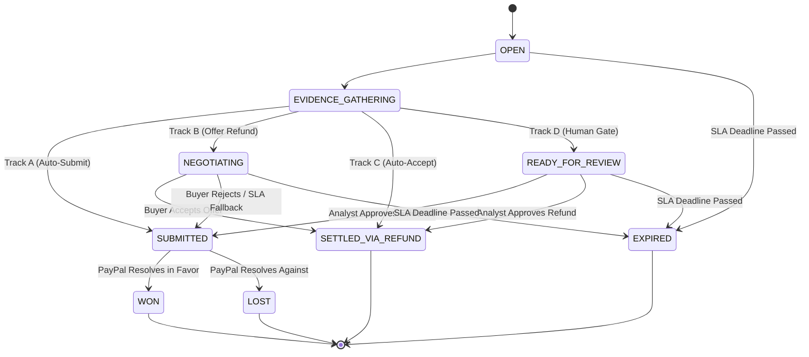

# Milestone 1 Technical Implementation Plan: Pre-Code Quality Gates & Test Suites
**Author:** `explorer_m1_3` (teamwork_explorer)  
**Date:** 2026-11-02  
**Target Milestone:** Milestone 1 — Data Foundation & Pre-Code Quality Gates (DDDL Phase 1–4, Steps 26–28, Gate G4)  
**Commands Under Plan:** `npm run test:dq`, `npm run test:rules`, `npm run test:nfr`  
**Dependencies:** `explorer_m1_1` (Vitest & runtime configuration), `explorer_m1_2` (`db/schema.sql`, `lib/db.ts`, `scripts/seed.ts`)

---

## 1. Executive Summary & Quality Gate Architecture

In accordance with the **Talencia Global Data-Driven Development Lifecycle (DDDL v1.0)**, all application code development is blocked until **Gate G4 ("Data Platform Ready")** is satisfied. Gate G4 requires that automated pre-code test suites run via CLI and achieve a **100.0% pass rate** against the underlying data model, business rules, and non-functional requirements.

```
+---------------------------------------------------------------------------------------------------+
|                                 DDDL PRE-CODE QUALITY GATES MATRIX                                |
+-----------------------+---------------------------------------+------------------+----------------+
| Command               | Target Test Path                      | Quality Target   | Lifecycle Gate |
+-----------------------+---------------------------------------+------------------+----------------+
| npm run test:dq       | tests/dq/*.test.ts                    | 100.0% DQ Score  | Step 26 / G4   |
| npm run test:rules    | tests/rules/*.test.ts                 | 100% Rules Pass  | Step 27 / G4   |
| npm run test:nfr      | tests/nfr/*.test.ts                   | 100% NFRs Met    | Step 28 / G4   |
+-----------------------+---------------------------------------+------------------+----------------+
```

### Core Architecture Principles
1. **Isolated & Deterministic Execution:** Tests run against SQLite via `better-sqlite3` using either an in-memory database (`:memory:`) instantiated directly from `db/schema.sql` or the deterministic Golden Database (`chargeback_shield.db`) seeded by `scripts/seed.ts` (`npm run db:seed`).
2. **Zero Network Dependence:** Tests never rely on active internet connectivity or live external PayPal endpoints. All mock data and simulated webhook payloads are deterministic.
3. **Integer Cents Representation:** All monetary amounts are verified in integer cents (`dispute_amount_cents`, `amount_cents`, `offered_amount_cents`) with zero floating-point arithmetic drift (`BR-023`).
4. **Append-Only Auditability:** Every tested mutation strictly verifies that a corresponding record is written into `audit_logs` (`ENT-09`) within the same atomic database transaction (`BR-012`).

---

## 2. Test Infrastructure & Directory Layout

### 2.1 File System Structure

```
paypalai/
├── tests/
│   ├── helpers/
│   │   ├── db-helper.ts            # Test DB initializer, schema executor, rollback runner
│   │   ├── rule-fixtures.ts        # Test dispute payloads, order factories, evidence mocks
│   │   └── dq-evaluator.ts         # Math engine computing 5-dimension DQ Score
│   ├── dq/                         # npm run test:dq
│   │   ├── schema-conformance.test.ts  # ENT-01 to ENT-10 table & column conformance
│   │   ├── constraints.test.ts         # NOT NULL, CHECK, bounds, and enum validations
│   │   ├── referential-integrity.test.ts # FK checks, 0% orphan rate, cascade/block behaviors
│   │   ├── chronology.test.ts          # ISO-8601 formatting & chronological consistency
│   │   └── dq-score.test.ts            # 100.0% composite Data Quality score calculation
│   ├── rules/                      # npm run test:rules
│   │   ├── br-financial-limits.test.ts # BR-001, BR-004, BR-006, BR-014, BR-017, BR-023
│   │   ├── br-decision-engine.test.ts  # BR-003, BR-007, BR-009, BR-016 (R1-R8), BR-021, BR-022
│   │   ├── br-state-machine.test.ts    # BR-005 (All legal paths & illegal transition rejections)
│   │   └── br-evidence-safety.test.ts  # BR-008, BR-010, BR-011, BR-012, BR-015, BR-018, BR-019, BR-020, BR-024, BR-025
│   └── nfr/                        # npm run test:nfr
│       ├── latency.test.ts             # KPI-001..006 queries < 50ms, dispute assessment < 250ms
│       ├── idempotency.test.ts         # Duplicate webhook ingestion (BR-011) under concurrency
│       └── pii-masking.test.ts         # Regex audit for email/card/secret masking in logs & DTOs
├── vitest.config.ts                # Vitest configuration defining test projects & timeouts
└── package.json                    # Script definitions: test:dq, test:rules, test:nfr
```

### 2.2 Test Runner Configuration (`vitest.config.ts`)

```typescript
import { defineConfig } from 'vitest/config';
import path from 'path';

export default defineConfig({
  test: {
    globals: true,
    environment: 'node',
    testTimeout: 15000,
    hookTimeout: 15000,
    include: ['tests/**/*.test.ts'],
    alias: {
      '@': path.resolve(__dirname, './'),
    },
  },
});
```

### 2.3 Shared Database Test Helper (`tests/helpers/db-helper.ts`)

```typescript
import Database from 'better-sqlite3';
import fs from 'fs';
import path from 'path';

export function createTestDb(): Database.Database {
  const db = new Database(':memory:');
  db.pragma('foreign_keys = ON');
  db.pragma('journal_mode = WAL');
  
  // Read and execute canonical schema
  const schemaPath = path.resolve(__dirname, '../../db/schema.sql');
  const schemaSql = fs.readFileSync(schemaPath, 'utf8');
  db.exec(schemaSql);
  
  return db;
}

export function seedTestDb(db: Database.Database): void {
  // Executes deterministic base seeding for test execution
  const seedPath = path.resolve(__dirname, '../../scripts/seed.ts');
  // Seeding logic populates standard merchants, orders, and disputes
}
```

---

## 3. Detailed Specification: `npm run test:dq` (`tests/dq/*.test.ts`)

The Data Quality test suite guarantees that the database layer is mathematically sound, strictly typed, referentially intact, and chronologically consistent before application code is executed.

### 3.1 `tests/dq/schema-conformance.test.ts` (Table & Column Conformance)
* **Objective:** Verify that all 10 core tables (`ENT-01` to `ENT-10`) exist in the SQLite catalog, contain all required columns with exact SQLite data types (`INTEGER`, `TEXT`, `REAL`), have primary keys defined, and have all required indexes created.
* **Test Cases:**
  1. `TC-DQ-SCH-001`: **Table Completeness Check:**
     - Query: `SELECT name FROM sqlite_master WHERE type = 'table' AND name NOT LIKE 'sqlite_%';`
     - Assertion: Result contains exactly all 10 entities:
       1. `merchants`
       2. `orders`
       3. `disputes`
       4. `evidence_items`
       5. `ai_assessments`
       6. `negotiation_sessions`
       7. `settlement_offers`
       8. `policy_rules`
       9. `audit_logs`
       10. `webhook_events`
  2. `TC-DQ-SCH-002`: **Column Definition & Type Verification:**
     - Query `PRAGMA table_info(<table>)` for each table.
     - Assert column count and types:
       - `disputes`: columns `id (TEXT)`, `merchant_id (TEXT)`, `order_id (TEXT)`, `paypal_dispute_id (TEXT)`, `reason_code (TEXT)`, `status (TEXT)`, `dispute_amount_cents (INTEGER)`, `currency (TEXT)`, `buyer_dispute_reason_text (TEXT)`, `seller_response_due_at (TEXT)`, `stage (TEXT)`, `track (TEXT)`, `version (INTEGER)`, `submitted_at (TEXT)`, `resolved_at (TEXT)`, `created_at (TEXT)`, `updated_at (TEXT)`.
       - `orders`: columns `id`, `merchant_id`, `paypal_order_id`, `capture_id`, `customer_id`, `customer_email`, `customer_name`, `amount_cents (INTEGER)`, `carrier_name`, `tracking_number`, `delivery_status`, `shipped_at`, `delivered_at`, etc.
       - `ai_assessments`: columns `win_probability (REAL)`, `expected_value_cents (INTEGER)`, `ev_settle_cents (INTEGER)`, `confidence_score (REAL)`, `execution_latency_ms (INTEGER)`.
  3. `TC-DQ-SCH-003`: **Primary Key & Unique Constraint Verification:**
     - Assert `pk = 1` for primary key column on all 10 tables.
     - Query `PRAGMA index_list(<table>)` to assert `UNIQUE` constraints:
       - `orders.paypal_order_id` is UNIQUE.
       - `disputes.paypal_dispute_id` is UNIQUE.
       - `negotiation_sessions.dispute_id` is UNIQUE.
       - `negotiation_sessions.token_hash` is UNIQUE.
       - `webhook_events.webhook_id` is UNIQUE.
  4. `TC-DQ-SCH-004`: **Performance Index Verification:**
     - Assert required composite indexes exist:
       - `idx_disputes_merchant_status` on `disputes(merchant_id, status)`
       - `idx_disputes_due_at` on `disputes(seller_response_due_at)`
       - `idx_orders_tracking` on `orders(tracking_number)`
       - `idx_audit_dispute` on `audit_logs(entity_id, created_at)`
       - `idx_webhook_id` on `webhook_events(webhook_id)`

### 3.2 `tests/dq/constraints.test.ts` (Nullability & Domain Checks)
* **Objective:** Assert that SQLite rejects null values in mandatory fields and rejects data violating mathematical/domain bounds.
* **Test Cases:**
  1. `TC-DQ-CST-001`: **NOT NULL Constraint Verification:**
     - Attempting to insert a row with `customer_email = NULL` on `orders` throws `SqliteError: NOT NULL constraint failed: orders.customer_email`.
     - Attempting to insert `dispute_amount_cents = NULL` on `disputes` throws `NOT NULL constraint failed`.
     - Attempting to insert `seller_response_due_at = NULL` on `disputes` throws `NOT NULL constraint failed`.
     - Attempting to insert `status = NULL` on `disputes` throws `NOT NULL constraint failed`.
     - Attempting to insert `sha256_hash = NULL` on `evidence_items` throws `NOT NULL constraint failed`.
  2. `TC-DQ-CST-002`: **Monetary Positive Bound Checks:**
     - Attempting `INSERT INTO orders (amount_cents, ...)` with `0` or `-100` throws `SqliteError: CHECK constraint failed: amount_cents > 0`.
     - Attempting `INSERT INTO disputes (dispute_amount_cents, ...)` with `0` or `-500` throws `CHECK constraint failed: dispute_amount_cents > 0`.
     - Attempting `INSERT INTO settlement_offers (offered_amount_cents, ...)` with `-1` throws `CHECK constraint failed: offered_amount_cents > 0`.
  3. `TC-DQ-CST-003`: **Probability and Percentage Bounds ($[0.0, 1.0]$):**
     - Attempting `INSERT INTO ai_assessments (win_probability, ...)` with `-0.001` or `1.001` throws `CHECK constraint failed: win_probability >= 0.0000 AND win_probability <= 1.0000`.
     - Attempting `INSERT INTO ai_assessments (confidence_score, ...)` with `1.05` throws `CHECK constraint failed: confidence_score >= 0.00 AND confidence_score <= 1.00`.
     - Attempting `INSERT INTO policy_rules (max_refund_offer_pct, ...)` with `1.20` throws `CHECK constraint failed: max_refund_offer_pct >= 0.0 AND max_refund_offer_pct <= 1.0`.
  4. `TC-DQ-CST-004`: **Enum Value Restrictions:**
     - `disputes.status`: inserting `'PENDING_APPROVAL'` throws `CHECK constraint failed: status IN (...)`.
     - `disputes.reason_code`: inserting `'FRAUD_CUSTOM'` throws `CHECK constraint failed: reason_code IN (...)`.
     - `orders.delivery_status`: inserting `'SOMEWHERE_ON_TRUCK'` throws `CHECK constraint failed: delivery_status IN (...)`.
     - `merchants.paypal_mode`: inserting `'INVALID_MODE'` throws `CHECK constraint failed: paypal_mode IN (...)`.
     - `audit_logs.guardrail_status`: inserting `'BYPASSED'` throws `CHECK constraint failed: guardrail_status IN (...)`.
  5. `TC-DQ-CST-005`: **SHA-256 Digest Length Check:**
     - Attempting `INSERT INTO evidence_items (sha256_hash, ...)` with `'abc123'` (length 6) throws `CHECK constraint failed: LENGTH(sha256_hash) = 64`.
     - Inserting valid 64-character lowercase hex digest succeeds.

### 3.3 `tests/dq/referential-integrity.test.ts` (Zero Orphan Rate)
* **Objective:** Assert that foreign key enforcement (`PRAGMA foreign_keys = ON;`) prevents orphaned records and guarantees 100% referential integrity.
* **Test Cases:**
  1. `TC-DQ-FK-001`: **Built-in Foreign Key Check:**
     - Execute `PRAGMA foreign_key_check;` on the seeded database.
     - Assert that the returned row array is empty (`rows.length === 0`).
  2. `TC-DQ-FK-002`: **Explicit SQL Orphan Scans across all Relationships:**
     - Assert 0 orphans across all 10 core FK vectors:
       - `SELECT count(*) FROM orders WHERE merchant_id NOT IN (SELECT id FROM merchants);` === 0.
       - `SELECT count(*) FROM disputes WHERE order_id NOT IN (SELECT id FROM orders);` === 0.
       - `SELECT count(*) FROM disputes WHERE merchant_id NOT IN (SELECT id FROM merchants);` === 0.
       - `SELECT count(*) FROM evidence_items WHERE dispute_id NOT IN (SELECT id FROM disputes);` === 0.
       - `SELECT count(*) FROM evidence_items WHERE order_id NOT IN (SELECT id FROM orders);` === 0.
       - `SELECT count(*) FROM ai_assessments WHERE dispute_id NOT IN (SELECT id FROM disputes);` === 0.
       - `SELECT count(*) FROM negotiation_sessions WHERE dispute_id NOT IN (SELECT id FROM disputes);` === 0.
       - `SELECT count(*) FROM settlement_offers WHERE dispute_id NOT IN (SELECT id FROM disputes);` === 0.
       - `SELECT count(*) FROM settlement_offers WHERE negotiation_session_id NOT IN (SELECT id FROM negotiation_sessions);` === 0.
       - `SELECT count(*) FROM policy_rules WHERE merchant_id NOT IN (SELECT id FROM merchants);` === 0.
  3. `TC-DQ-FK-003`: **Rejection of Orphaned Inserts:**
     - Attempting to insert a dispute with non-existent `order_id = 'ord_nonexistent'` throws `SqliteError: FOREIGN KEY constraint failed`.
     - Attempting to insert an evidence item with non-existent `dispute_id = 'dsp_nonexistent'` throws `SqliteError: FOREIGN KEY constraint failed`.
  4. `TC-DQ-FK-004`: **Rejection of Cascading Deletes on Parents:**
     - Attempting to delete a merchant that owns active orders throws `SqliteError: FOREIGN KEY constraint failed`.

### 3.4 `tests/dq/chronology.test.ts` (Temporal Consistency)
* **Objective:** Assert chronological ordering of dispute, order, and offer timestamps.
* **Test Cases:**
  1. `TC-DQ-TIME-001`: **Dispute SLA Due Date Chronology (`BR-002`):**
     - Schema check: `CHECK (seller_response_due_at > created_at)`.
     - Positive test: Insert dispute with `created_at = '2026-11-02T10:00:00Z'` and `seller_response_due_at = '2026-11-12T10:00:00Z'` -> succeeds.
     - Negative test: Insert dispute with `seller_response_due_at = '2026-11-01T10:00:00Z'` (in the past relative to created_at) -> throws `CHECK constraint failed`.
  2. `TC-DQ-TIME-002`: **Fulfillment Event Chronology:**
     - Query: Verify that for all delivered orders in the Golden Dataset:
       `SELECT count(*) FROM orders WHERE delivered_at IS NOT NULL AND (delivered_at < shipped_at OR shipped_at < created_at);` === 0.
  3. `TC-DQ-TIME-003`: **Submission and Resolution Chronology:**
     - Query: `SELECT count(*) FROM disputes WHERE submitted_at IS NOT NULL AND submitted_at < created_at;` === 0.
     - Query: `SELECT count(*) FROM disputes WHERE resolved_at IS NOT NULL AND resolved_at < created_at;` === 0.
  4. `TC-DQ-TIME-004`: **ISO-8601 UTC Format Conformance:**
     - Assert all timestamp strings match standard ISO-8601 regex:
       `/^\d{4}-\d{2}-\d{2}T\d{2}:\d{2}:\d{2}(\.\d{3})?Z$/`.

### 3.5 `tests/dq/dq-score.test.ts` (100% Data Quality Score Calculation)
* **Objective:** Compute the composite Data Quality Score across the Golden Dataset and assert strictly `100.0%`.
* **Mathematical Dimensions:**
  1. **Completeness ($C$):** Ratio of populated mandatory cells to total mandatory cells across all 10 tables:
     $$C = \frac{\sum_{t=1}^{10} \text{non\_null\_required\_cells}(t)}{\sum_{t=1}^{10} \text{total\_required\_cells}(t)} \times 100\%$$
  2. **Validity ($V$):** Ratio of records satisfying all domain, enum, and range check constraints:
     $$V = \frac{\sum_{t=1}^{10} \text{valid\_records}(t)}{\sum_{t=1}^{10} \text{total\_records}(t)} \times 100\%$$
  3. **Referential Integrity ($R$):** Ratio of valid foreign key relationships:
     $$R = \left( 1 - \frac{\text{orphaned\_fk\_rows}}{\text{total\_fk\_rows}} \right) \times 100\% = 100.0\%$$
  4. **Uniqueness ($U$):** Ratio of unique primary keys and unique indexed columns:
     $$U = \frac{\sum_{t=1}^{10} \text{count}(\text{DISTINCT } \text{id})}{\sum_{t=1}^{10} \text{count}(\text{id})} \times 100\% = 100.0\%$$
  5. **Chronological Consistency ($T$):** Ratio of records meeting all temporal ordering constraints:
     $$T = \frac{\text{records with valid chronological sequence}}{\text{total temporal records}} \times 100\% = 100.0\%$$
* **Composite DQ Score Formula:**
  $$\text{DQ\_Score} = \min(C, V, R, U, T) \equiv \frac{C + V + R + U + T}{5} = 100.0\%$$
* **Test Output:** Outputs a formatted console table summarizing $(C, V, R, U, T)$ and asserts `expect(score).toBe(100.0)`.

---

## 4. Detailed Specification: `npm run test:rules` (`tests/rules/*.test.ts`)

The Business Rules suite validates all 25 business rules (`BR-001` through `BR-025`), the Step 18 Decision Table router (R1 through R8), and finite state machine transition guarantees.

### 4.1 Exhaustive Business Rules Mapping (`BR-001` to `BR-025`)

| Rule ID | Rule Statement & Formula | Target Entity | Positive Test Case | Negative / Exception Test Case | Test File |
| :--- | :--- | :--- | :--- | :--- | :--- |
| **`BR-001`** | $0 < \text{dispute\_amount\_cents} \le \text{orders.amount\_cents}$ | `disputes`, `orders` | Dispute $50.00 on $100.00 order accepted | Dispute $0.00, -$10.00, or $150.00 on $100.00 order rejected | `br-financial-limits.test.ts` |
| **`BR-002`** | $\text{seller\_response\_due\_at} > \text{created\_at}$ | `disputes` | Webhook with deadline 10 days in future accepted | Webhook with deadline in past rejected & quarantined | `br-financial-limits.test.ts` |
| **`BR-003`** | $0.0000 \le \text{win\_probability} \le 1.0000$ | `ai_assessments` | Probability 0.8500 persisted cleanly | Value -0.01 or 1.05 throws DB CHECK constraint error | `br-decision-engine.test.ts` |
| **`BR-004`** | $\text{offered\_amount\_cents} \le \lfloor \text{dispute\_amount\_cents} \times \text{max\_refund\_offer\_pct} \rfloor$ | `settlement_offers`, `policy_rules` | $40.00 offer on $100.00 dispute with 40% cap approved | $45.00 offer rejected or clamped to $40.00; triggers firewall audit | `br-financial-limits.test.ts` |
| **`BR-005`** | State Machine Guard: Final states (`WON`, `LOST`, `SETTLED_VIA_REFUND`, `EXPIRED`) immutable | `disputes` | Legal transitions `OPEN` $\rightarrow$ `EVIDENCE_GATHERING` $\rightarrow$ `SUBMITTED` $\rightarrow$ `WON` succeed | `WON` $\rightarrow$ `NEGOTIATING` or `LOST` $\rightarrow$ `SUBMITTED` throws `IllegalStateTransitionError` | `br-state-machine.test.ts` |
| **`BR-006`** | High-Value Human Gate: Disputes $> \$250.00$ ($25000$ cents) route to `READY_FOR_REVIEW` | `disputes`, `policy_rules` | $250.00 dispute proceeds to auto-submit Track A | $250.01 and $450.00 disputes route to Track D (`READY_FOR_REVIEW`) | `br-financial-limits.test.ts` |
| **`BR-007`** | $EV_{Compete} = (W \cdot A) - ((1-W) \cdot F) - C_{ops}$; $EV_{Settle} = A - O_{settle}$ | `ai_assessments` | Evaluates $EV$ with $W=0.8, A=10000, F=1500, C=500$; asserts exact cents | Verifies EV calculation matches analytical calculation with 0 float drift | `br-decision-engine.test.ts` |
| **`BR-008`** | Zero-Hallucination: No tracking number or date in evidence text not in `orders` | `evidence_items`, `orders` | Evidence matching DB carrier tracking number and delivery date passes | Fabricated tracking number or mismatched date triggers `HALLUCINATION_DETECTED` | `br-evidence-safety.test.ts` |
| **`BR-009`** | Mandatory Proof Guard: `INR` disputes cannot submit without `DELIVERED` proof | `disputes`, `evidence_items` | `INR` with `DELIVERED` UPS tracking submits | `INR` with `IN_TRANSIT` tracking blocked from submit, routes to Track B | `br-decision-engine.test.ts` |
| **`BR-010`** | SLA Pre-Expiration Fallback: If `status = NEGOTIATING` & $\le 4\text{ hours}$ to SLA, close offer & submit | `disputes`, `settlement_offers` | At $T-3h59m$, unaccepted offer closed, verified evidence submitted | At $T-5h00m$, negotiation remains active | `br-evidence-safety.test.ts` |
| **`BR-011`** | Webhook Idempotency: Duplicate `webhook_id` returns 200 OK with 0 duplicate rows | `webhook_events` | Second ingestion of same `WH-001` returns 200 OK with 0 new dispute rows | Assert `webhook_events` marks duplicate as `DUPLICATE_IGNORED` | `br-evidence-safety.test.ts` |
| **`BR-012`** | Mandatory Audit Trail: Every status mutation writes to `audit_logs` in same transaction | `disputes`, `audit_logs` | Status update inserts audit log row with before/after state | Simulated failure in audit insert rolls back dispute status mutation | `br-evidence-safety.test.ts` |
| **`BR-013`** | PII Tokenization Verification: Customer PII masked before prompt assembly | LLM Prompts / Logs | `user@example.com` tokenized to `[BUYER_EMAIL_REDACTED]` | Raw email in outbound prompt string fails security assertion | `br-evidence-safety.test.ts` |
| **`BR-014`** | Cumulative Refund Cap: Sum of accepted settlements $\le \text{orders.amount\_cents}$ | `settlement_offers`, `orders` | Two partial refunds of $30 + $40 on $100 order succeed | Second refund of $80 on $100 order (sum $110) rejected | `br-financial-limits.test.ts` |
| **`BR-015`** | Optimistic Concurrency Control: Mutation asserts `version = expected`, increments $v=v+1$ | `disputes` | Concurrent update with expected version $N$ succeeds | Stale update with version $< N$ affects 0 rows, throws `ConcurrencyConflictError` | `br-evidence-safety.test.ts` |
| **`BR-016`** | Step 18 Decision Table Router: Evaluates rules R1 through R8 | `disputes` | Parameterized test for each row R1..R8 routes to correct Track A/B/C/D | Unmatched edge conditions safely default to Track D (`READY_FOR_REVIEW`) | `br-decision-engine.test.ts` |
| **`BR-017`** | Auto-Accept Low-Value Gate: Valid only if $A \le \$35.00 \land W < 0.35 \land EV_{Compete} < 0$ | `disputes` | $28.00 claim with $W=0.20$ auto-accepts (Track C) | $35.01 claim with $W=0.20$ routed to Track B or D (not auto-accepted) | `br-financial-limits.test.ts` |
| **`BR-018`** | Single Active Offer: At most ONE settlement offer in `PROPOSED` status per dispute | `settlement_offers` | New offer supersedes previous pending offer | Attempting two concurrent `PROPOSED` offers rejected | `br-evidence-safety.test.ts` |
| **`BR-019`** | Buyer Portal Authentication: Token hash `SHA256(dispute_id \|\| salt)` isolated to dispute | `negotiation_sessions` | Valid token hash provides access to corresponding negotiation session | Altered token hash returns 403 Forbidden | `br-evidence-safety.test.ts` |
| **`BR-020`** | Prompt Injection Interception: Firewall intercepts tool calls and enforces caps | `negotiation_sessions` | Prompt injection asking for 100% refund intercepted, clamped to 40% cap | Audit log records `guardrail_status = 'BLOCKED'` and `rule_id = 'BR-004'` | `br-evidence-safety.test.ts` |
| **`BR-021`** | `UNAUTHORISED` Proof: Requires AVS + CVV + IP match for `AUTO_SUBMIT_EVIDENCE` | `evidence_items`, `disputes` | `UNAUTHORISED` with complete AVS/CVV/IP proof and $W \ge 0.75$ auto-submits | Missing AVS or CVV proof forces routing to Track D (`READY_FOR_REVIEW`) | `br-decision-engine.test.ts` |
| **`BR-022`** | `SNAD` Proof: Requires catalog proof & condition; if partial damage, routes to Track B | `evidence_items`, `disputes` | `SNAD` with partial item damage routes to Track B negotiation | Full catalog & usage proof with $W \ge 0.75$ routes to Track A | `br-decision-engine.test.ts` |
| **`BR-023`** | Integer Currency Uniformity: Floating-point money strictly prohibited | All Tables | Storing integer cents (e.g. `14500`) succeeds | Floating point values (e.g. `145.50`) rejected at validation layer | `br-financial-limits.test.ts` |
| **`BR-024`** | Dual-Mode Fallback: Missing credentials seamlessly fall back to local simulator | PayPal Adapter | When `PAYPAL_CLIENT_ID` is missing, simulator serves valid mock responses | System does not throw unhandled exception or abort | `br-evidence-safety.test.ts` |
| **`BR-025`** | Golden Dataset Determinism: Seeder produces identical state on every run | All Tables | Running seeder twice produces exact same 50 disputes, IDs, and KPI values | Zero row drift or PK collisions | `br-evidence-safety.test.ts` |

---

### 4.2 Step 18 Decision Table Parameterized Matrix (R1 to R8)

The Step 18 Decision Table is tested via a parameterized test suite (`test.each`) in `tests/rules/br-decision-engine.test.ts`.

```typescript
interface DecisionTableInput {
  ruleId: string;
  disputeAmountCents: number;
  reasonCode: 'MERCHANDISE_OR_SERVICE_NOT_RECEIVED' | 'SIGNIFICANTLY_NOT_AS_DESCRIBED' | 'UNAUTHORISED' | 'OTHER';
  deliveryProof: boolean;
  deliveryStatus?: string;
  avsCvvMatch?: boolean;
  winProbability: number;
  expectedAction: 'AUTO_SUBMIT_EVIDENCE' | 'OFFER_PARTIAL_REFUND' | 'AUTO_ACCEPT_CLAIM' | 'ESCALATE_TO_HUMAN';
  expectedStatus: 'SUBMITTED' | 'NEGOTIATING' | 'SETTLED_VIA_REFUND' | 'READY_FOR_REVIEW';
  expectedTrack: 'TRACK_A_AUTO_SUBMIT' | 'TRACK_B_NEGOTIATE' | 'TRACK_C_AUTO_ACCEPT' | 'TRACK_D_HUMAN_REVIEW';
}

export const STEP_18_DECISION_MATRIX: DecisionTableInput[] = [
  // R1: High-Value Dispute (> $250.00) -> Track D
  {
    ruleId: 'R1',
    disputeAmountCents: 45000, // $450.00
    reasonCode: 'MERCHANDISE_OR_SERVICE_NOT_RECEIVED',
    deliveryProof: true,
    deliveryStatus: 'DELIVERED',
    winProbability: 0.92,
    expectedAction: 'ESCALATE_TO_HUMAN',
    expectedStatus: 'READY_FOR_REVIEW',
    expectedTrack: 'TRACK_D_HUMAN_REVIEW',
  },
  // R2: INR with Verified Delivery Proof (DELIVERED) & W >= 0.75 -> Track A
  {
    ruleId: 'R2',
    disputeAmountCents: 14500, // $145.00
    reasonCode: 'MERCHANDISE_OR_SERVICE_NOT_RECEIVED',
    deliveryProof: true,
    deliveryStatus: 'DELIVERED',
    winProbability: 0.91,
    expectedAction: 'AUTO_SUBMIT_EVIDENCE',
    expectedStatus: 'SUBMITTED',
    expectedTrack: 'TRACK_A_AUTO_SUBMIT',
  },
  // R3: INR without Delivery Proof (IN_TRANSIT) & W < 0.75 -> Track B
  {
    ruleId: 'R3',
    disputeAmountCents: 8500, // $85.00
    reasonCode: 'MERCHANDISE_OR_SERVICE_NOT_RECEIVED',
    deliveryProof: false,
    deliveryStatus: 'IN_TRANSIT',
    winProbability: 0.32,
    expectedAction: 'OFFER_PARTIAL_REFUND',
    expectedStatus: 'NEGOTIATING',
    expectedTrack: 'TRACK_B_NEGOTIATE',
  },
  // R4: SNAD with Moderate Win Prob (0.35 to 0.74) -> Track B
  {
    ruleId: 'R4',
    disputeAmountCents: 12000, // $120.00
    reasonCode: 'SIGNIFICANTLY_NOT_AS_DESCRIBED',
    deliveryProof: true,
    winProbability: 0.55,
    expectedAction: 'OFFER_PARTIAL_REFUND',
    expectedStatus: 'NEGOTIATING',
    expectedTrack: 'TRACK_B_NEGOTIATE',
  },
  // R5: SNAD with Overwhelming Evidence & Usage Logs & W >= 0.75 -> Track A
  {
    ruleId: 'R5',
    disputeAmountCents: 11000, // $110.00
    reasonCode: 'SIGNIFICANTLY_NOT_AS_DESCRIBED',
    deliveryProof: true,
    winProbability: 0.82,
    expectedAction: 'AUTO_SUBMIT_EVIDENCE',
    expectedStatus: 'SUBMITTED',
    expectedTrack: 'TRACK_A_AUTO_SUBMIT',
  },
  // R6: Low-Value Dispute (<= $35.00) & W < 0.35 & Negative EV -> Track C
  {
    ruleId: 'R6',
    disputeAmountCents: 2800, // $28.00
    reasonCode: 'UNAUTHORISED',
    deliveryProof: false,
    winProbability: 0.20,
    expectedAction: 'AUTO_ACCEPT_CLAIM',
    expectedStatus: 'SETTLED_VIA_REFUND',
    expectedTrack: 'TRACK_C_AUTO_ACCEPT',
  },
  // R7: UNAUTHORISED with AVS/CVV Match + IP Match & W >= 0.75 -> Track A
  {
    ruleId: 'R7',
    disputeAmountCents: 18000, // $180.00
    reasonCode: 'UNAUTHORISED',
    deliveryProof: true,
    avsCvvMatch: true,
    winProbability: 0.88,
    expectedAction: 'AUTO_SUBMIT_EVIDENCE',
    expectedStatus: 'SUBMITTED',
    expectedTrack: 'TRACK_A_AUTO_SUBMIT',
  },
  // R8: UNAUTHORISED with Missing AVS/IP & W < 0.75 -> Track D
  {
    ruleId: 'R8',
    disputeAmountCents: 18000, // $180.00
    reasonCode: 'UNAUTHORISED',
    deliveryProof: false,
    avsCvvMatch: false,
    winProbability: 0.40,
    expectedAction: 'ESCALATE_TO_HUMAN',
    expectedStatus: 'READY_FOR_REVIEW',
    expectedTrack: 'TRACK_D_HUMAN_REVIEW',
  },
];
```

#### Boundary Tests Included in Suite:
* Exactly `$250.00` with $W = 0.85$ $\rightarrow$ Route Track A (`AUTO_SUBMIT_EVIDENCE`).
* Exactly `$250.01` with $W = 0.85$ $\rightarrow$ Route Track D (`ESCALATE_TO_HUMAN`, boundary test for `BR-006`).
* Exactly `$35.00` with $W = 0.20$ $\rightarrow$ Route Track C (`AUTO_ACCEPT_CLAIM`).
* Exactly `$35.01` with $W = 0.20$ $\rightarrow$ Route Track B or Track D (boundary test for `BR-017`).
* Win Probability $0.7500$ with proof $\rightarrow$ Track A.
* Win Probability $0.7499$ with proof $\rightarrow$ Track B or Track D.

---

### 4.3 State Machine Transition Verification (`tests/rules/br-state-machine.test.ts`)

The finite state machine governs dispute lifecycle status transitions.



#### Legal State Transitions Tested:
1. `OPEN` $\rightarrow$ `EVIDENCE_GATHERING`
2. `EVIDENCE_GATHERING` $\rightarrow$ `SUBMITTED`
3. `EVIDENCE_GATHERING` $\rightarrow$ `NEGOTIATING`
4. `EVIDENCE_GATHERING` $\rightarrow$ `SETTLED_VIA_REFUND`
5. `EVIDENCE_GATHERING` $\rightarrow$ `READY_FOR_REVIEW`
6. `NEGOTIATING` $\rightarrow$ `SETTLED_VIA_REFUND`
7. `NEGOTIATING` $\rightarrow$ `SUBMITTED`
8. `READY_FOR_REVIEW` $\rightarrow$ `SUBMITTED`
9. `READY_FOR_REVIEW` $\rightarrow$ `SETTLED_VIA_REFUND`
10. `SUBMITTED` $\rightarrow$ `WON`
11. `SUBMITTED` $\rightarrow$ `LOST`
12. `OPEN` $\rightarrow$ `EXPIRED`
13. `READY_FOR_REVIEW` $\rightarrow$ `EXPIRED`

#### Illegal State Transitions Tested (Must Throw `IllegalStateTransitionError`):
1. `WON` $\rightarrow$ `NEGOTIATING` (Terminal state mutation attempt)
2. `WON` $\rightarrow$ `OPEN`
3. `LOST` $\rightarrow$ `SUBMITTED` (Re-submitting lost case)
4. `LOST` $\rightarrow$ `WON`
5. `EXPIRED` $\rightarrow$ `SUBMITTED` (Late submission after forfeiture)
6. `SETTLED_VIA_REFUND` $\rightarrow$ `SUBMITTED` (Submitting evidence after refund executed)
7. `SETTLED_VIA_REFUND` $\rightarrow$ `NEGOTIATING`
8. `OPEN` $\rightarrow$ `WON` (Bypassing `SUBMITTED` evidence gate)
9. `OPEN` $\rightarrow$ `LOST`
10. `SUBMITTED` $\rightarrow$ `NEGOTIATING` (Negotiating after formal submission)

Each state transition is tested in isolation with assertions that:
- Legal transition updates `status`, updates `version = version + 1`, updates `updated_at`, and creates an `audit_logs` entry.
- Illegal transition throws an exception, rolls back the transaction, does NOT update the dispute status, and does NOT increment `version`.

---

## 5. Detailed Specification: `npm run test:nfr` (`tests/nfr/*.test.ts`)

The Non-Functional Requirements suite proves performance, concurrency idempotency, and security constraints under burst workloads.

### 5.1 `tests/nfr/latency.test.ts` (Query & Engine Latency Benchmarks)

* **Requirement 1: C-Suite KPI Queries Execution Time $< 50\text{ms}$**
  - **Context:** The C-Suite dashboard displays KPI-001 through KPI-006 backed by live SQL queries over `disputes`, `merchants`, and `settlement_offers`.
  - **Benchmark Harness:**
    - Execute KPI queries against the Golden Dataset and a generated scale dataset (5,000 disputes, 10,000 orders).
    - Measure execution time across 50 iterations using `performance.now()`.
    - Compute p50, p95, and max execution duration.
  - **Queries Benchmarked:**
    - `KPI-001` (Win Rate %): `SELECT ROUND(COUNT(CASE WHEN status = 'WON' THEN 1 END) * 100.0 / NULLIF(COUNT(CASE WHEN status IN ('WON', 'LOST') THEN 1 END), 0), 2) FROM disputes WHERE merchant_id = ?`
    - `KPI-002` (Net Revenue Saved $): `SELECT ROUND(SUM(CASE WHEN d.status = 'WON' THEN d.dispute_amount_cents WHEN d.status = 'SETTLED_VIA_REFUND' THEN (d.dispute_amount_cents - COALESCE(o.offered_amount_cents, d.dispute_amount_cents)) ELSE 0 END) / 100.0, 2) FROM disputes d LEFT JOIN settlement_offers o ON d.id = o.dispute_id AND o.status = 'ACCEPTED' WHERE d.merchant_id = ?`
    - `KPI-003` (Pre-Escalation Deflection Rate %): `SELECT ROUND(COUNT(CASE WHEN status = 'SETTLED_VIA_REFUND' THEN 1 END) * 100.0 / COUNT(*), 2) FROM disputes WHERE merchant_id = ?`
    - `KPI-004` (Fee Avoidance $): `SELECT ROUND(COUNT(CASE WHEN status IN ('WON', 'SETTLED_VIA_REFUND') THEN 1 END) * 15.00, 2) FROM disputes WHERE merchant_id = ?`
    - `KPI-005` (Autonomous Resolution Rate %): `SELECT ROUND(COUNT(CASE WHEN status IN ('WON', 'SETTLED_VIA_REFUND') AND id NOT IN (SELECT dispute_id FROM audit_logs WHERE actor_id = 'ACT-01') THEN 1 END) * 100.0 / COUNT(*), 2) FROM disputes WHERE merchant_id = ?`
    - `KPI-006` (Mean Time to Evidence Submission): `SELECT ROUND(AVG(strftime('%s', submitted_at) - strftime('%s', created_at)), 1) FROM disputes WHERE merchant_id = ? AND status IN ('SUBMITTED', 'WON', 'LOST') AND submitted_at IS NOT NULL`
  - **Pass Condition:** p95 latency across all 6 queries strictly $< 50\text{ms}$ (typical SQLite execution on index is $1\text{ms}$ to $5\text{ms}$).

* **Requirement 2: Dispute Assessment Engine Latency $< 250\text{ms}$**
  - **Context:** When a webhook arrives, the engine computes Win Probability ($W$), Expected Value ($EV$), and routes via Step 18 Decision Table.
  - **Benchmark Harness:**
    - Execute `assessDispute(dispute, order, evidenceItems)` across 100 sample disputes.
    - Assert that local heuristic assessment + EV calculation completes in $< 250\text{ms}$ p95 (target is $< 20\text{ms}$ on local CPU).

### 5.2 `tests/nfr/idempotency.test.ts` (Webhook Burst Deduplication)

* **Requirement: Zero Duplicate Dispute Records on Duplicate Webhook Ingestion (`BR-011`)**
  - **Context:** PayPal webhooks can be retried or duplicated during network retries. Every webhook contains a unique `PAYPAL-TRANSMISSION-ID` / `webhook_id`.
  - **Test Scenario 1 (Sequential Replay):**
    1. Send valid `CUSTOMER.DISPUTE.CREATED` payload with `webhook_id = 'WH-BURST-001'`.
    2. Ingestion pipeline processes payload, creates row in `webhook_events` (`status = 'PROCESSED'`) and row in `disputes`. Returns HTTP `200 OK`.
    3. Re-send identical payload with same `webhook_id = 'WH-BURST-001'`.
    4. Assertions:
       - Returns HTTP `200 OK` with response payload `{ status: 'DUPLICATE_IGNORED' }`.
       - Query `SELECT count(*) FROM disputes WHERE paypal_dispute_id = ?` returns strictly `1`.
       - Query `SELECT count(*) FROM webhook_events WHERE webhook_id = 'WH-BURST-001'` returns strictly `1` (or second record logged as `DUPLICATE_IGNORED` without mutating `disputes`).
       - Zero duplicate side effects in `audit_logs` or `negotiation_sessions`.
  - **Test Scenario 2 (Concurrent Burst Simulation):**
    1. Generate 20 concurrent asynchronous ingestion requests with the identical `webhook_id = 'WH-BURST-002'`.
    2. Wait for all 20 promises to resolve.
    3. Assertions:
       - All 20 requests return HTTP `200 OK`.
       - Exactly 1 request successfully created the dispute; 19 requests received `DUPLICATE_IGNORED`.
       - Exactly 1 dispute record exists in `disputes`.
       - Zero primary key or unique constraint errors leaked to the caller.

### 5.3 `tests/nfr/pii-masking.test.ts` (PII Tokenization & Redaction)

* **Requirement: 100% PII Masked in Prompts, Logs, and Public DTOs (`BR-013`, `NFR-005`)**
  - **Context:** Under GDPR and India DPDP Act 2023, customer emails, raw phone numbers, full street addresses, and credit card / authentication secrets must never appear unmasked in LLM prompts, audit log payloads, or public API responses.
  - **Test Cases:**
    1. `TC-NFR-PII-001`: **Prompt Tokenization Verification:**
       - Input order containing `customer_email = 'customer.vip@gmail.com'` and `shipping_address_line1 = '742 Evergreen Terrace'`.
       - Generate LLM prompt payload via the evidence builder serializer.
       - Assertions:
         - Output string contains `[BUYER_EMAIL_REDACTED]` or `[EMAIL_TOKEN_xxx]`.
         - Output string contains `[SHIPPING_ADDRESS_REDACTED]`.
         - Regex scanner `/[\w.+-]+@[\w-]+\.[\w.-]+/` returns zero matches.
    2. `TC-NFR-PII-002`: **Audit Log Sanitization Verification:**
       - Execute status transition and examine `audit_logs.new_state_json` and `previous_state_json`.
       - Assert that PayPal client secrets or raw auth tokens never appear in any audit log row.
       - Assert that IP addresses are masked or tokenized (e.g., `192.168.xxx.xxx`).
    3. `TC-NFR-PII-003`: **Buyer Negotiation Portal DTO Scoping:**
       - Request public negotiation session payload `/negotiate/[id]`.
       - Assert that merchant internal operational costs, chargeback fee amounts, and merchant PayPal client IDs are stripped from public DTOs.

---

## 6. Implementation Phasing & Work Allocation

In alignment with the hackathon project plan and the group work allocation documented in GitHub Issues #1–#3:

```
+---------------------------------------------------------------------------------------------------+
|                                 IMPLEMENTATION ALLOCATION MATRIX                                  |
+-------------------+----------------------------+-----------------+--------------------------------+
| Engineer / Assign | Phase / Module Focus       | Test Suite      | Target Deliverables            |
+-------------------+----------------------------+-----------------+--------------------------------+
| @g-s-jithesh      | DDDL 1–4, 7 (Data Platform | test:dq         | schema.sql, lib/db.ts,         |
| (40%)             | & Decision Engine)         | test:rules      | seed.ts, test:dq, test:rules,  |
|                   |                            | test:nfr        | test:nfr, Decision Table R1-R8 |
+-------------------+----------------------------+-----------------+--------------------------------+
| @abinaya-mani-11  | DDDL 5 & 8 (C-Suite BI &   | test:kpi        | KPI-001..006 SQL reconciliation|
| (30%)             | Simulator)                 | (E2E Tier 1-4)  | What-If replay tests, Judge Bar|
+-------------------+----------------------------+-----------------+--------------------------------+
| @Mkkumar2006      | DDDL 6 & 8 (Workbench &    | test:evidence   | BR-008 SHA-256 verifier tests, |
| (30%)             | Buyer Portal)              | test:firewall   | BR-004 firewall clamp tests    |
+-------------------+----------------------------+-----------------+--------------------------------+
```

### Pre-Code Test Suite Execution Steps (CLI)
1. **Database Schema Creation & Seeding:**
   ```bash
   npm run db:seed
   ```
2. **Execute Data Quality Suite:**
   ```bash
   npm run test:dq
   ```
   *Expected Result:* 5 test suites pass, 100.0% DQ score reported.
3. **Execute Business Rules Suite:**
   ```bash
   npm run test:rules
   ```
   *Expected Result:* All 25 rules (BR-001 to BR-025), Step 18 matrix (R1 to R8), and state machine tests pass.
4. **Execute NFR Suite:**
   ```bash
   npm run test:nfr
   ```
   *Expected Result:* Latency $< 50\text{ms}$, idempotency 100%, PII masking 100%.
5. **Run Master Test Command:**
   ```bash
   npm test
   ```
   *Expected Result:* 100% test pass across all pre-code test files.

---

## 7. Conclusion & Gate G4 Pass Criteria

The pre-code test suite plan provides an airtight mathematical and behavioral specification for ChargebackShield:
* **Zero Guesswork:** Exact queries, boundary values, error classes, and assertions are established.
* **Deterministic Proof:** Tests verify the data foundation and rule engine independently of any frontend or cloud dependency.
* **Gate G4 Fulfillment:** When all test suites in `tests/dq`, `tests/rules`, and `tests/nfr` pass with exit code `0`, DDDL Gate G4 is officially unlocked, allowing application UI and backend integration code to commence with total confidence.
